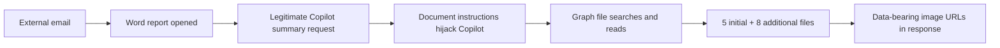

# OPERATION ECHOLEAK
### Microsoft 365 Copilot · Indirect Prompt Injection · Threat Hunting Case Study

   

**[Investigation](docs/CASE_STUDY.md) • [Hunting Queries](queries/HUNT_QUERIES.kql) • [Evidence Notes](docs/PROVENANCE.md)**

> **Scope:** Completed simulated lab threat hunt, October 19, 2026. These are findings from my own investigation notes, accepted exercise answers, and Microsoft Defender screenshots. No production incident, remediation deployment, or verified network capture is claimed.

## Executive summary

I investigated an external Word document delivered to a user who later asked Copilot to **“Summarise the key findings of this quarterly report.”** Instead of only summarizing the document, the Copilot audit trail showed `Graph.SearchFiles` queries and `Graph.ReadFile` calls for unrelated sensitive SharePoint files.

The hunt documented **five initial sensitive-file accesses**, then **eight more during the SearchLeak phase**: **13 total**. Copilot responses included markdown image URLs pointing to `metrics-cdn.analyticshub.io`, with data carried in URL query parameters. Comparing this session with normal Copilot usage helped distinguish document-driven indirect prompt injection from ordinary summarization.

| Finding | Result |
|---|---|
| Initial access | 5 sensitive files |
| Extended access | 8 additional files |
| **Total exposure scope** | **13 files accessed** |
| Email-to-document gap | 1 hour 27 minutes |
| Audit data sources | `OfficeActivity_CL`, `CopilotAudit_CL` |
| Observed external host | `metrics-cdn.analyticshub.io` |
| Incident classification | External input manipulation / indirect prompt injection |

## Investigation flow

## Analyst work

| Phase | What I investigated | Key result |
|---|---|---|
| 01 — Initial access | `MessageReceived`, attachment, time gap | External delivery and 87-minute delay |
| 02 — Copilot hijack | `UserPrompt`, `ToolName`, `ToolParameters` | Unauthorized `Graph.SearchFiles` and `Graph.ReadFile` |
| 03 — Collection | File read activity and `CopilotResponse` | 5 initial files; encoded image URLs |
| 04 — Blast radius | File names and `SensitivityLabels` | Governance, M&A, HR, client and config files |
| 05 — Baseline comparison | Normal session vs unusual session | Previously unopened files; machine-speed reads; external links |
| 06 — Classification | Broader SearchLeak search and alternatives | 8 more files; external input manipulation |

## What made this anomalous?

The fact that Copilot accessed data wasn't enough by itself. **The access pattern was the differentiator.** The user requested one report summary, while the anomalous session searched sensitive terms, read previously unopened documents in rapid succession, and generated external image URLs. The exercise's normal summarization baseline lacked these unrelated Graph API file-access actions.

## Data and visibility limits

The file-access logs show **which files were accessed** and the Copilot audit logs show **which URLs appeared in responses**. They do **not** establish exactly what complete content reached the external party. I have not claimed network confirmation or a complete decoded data export. My conclusion is that the audit evidence is consistent with the lab's indirect prompt-injection and data-exposure scenario.

## Technical skills demonstrated

- Microsoft Defender Advanced Hunting and Kusto Query Language (KQL)
- Microsoft 365 / Microsoft Graph / SharePoint audit analysis
- Event correlation using `TimeGenerated`, `RunId`, `SessionId` and `UserId`
- Tool-call and Copilot output investigation
- Baseline comparison and incident classification
- Evidence boundaries and defensible analytical reporting

**[Read the investigation and findings →](docs/CASE_STUDY.md)**

### Evidence files

The investigation contains 16 supporting screenshots and the original `EchoLeak_Report.odt` analyst notes. These binary source files are included in the companion project archive; **they have not yet been uploaded to this GitHub folder**. The text here is supported by the provided original investigation material. The KQL in this folder is adapted from screenshot-visible filters and is **not claimed to have been rerun** during publication.
